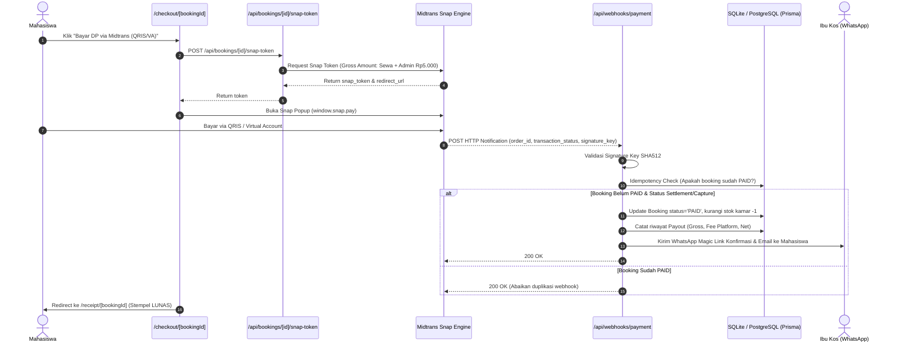

# [Feature] Integrasi Payment Gateway Riil (Midtrans Snap/QRIS & VA), Skema Monetisasi, dan Invoice Digital

> **Target Pelaksana:** Junior Programmer / Budget-Friendly AI Model  
> **Status:** Ready to Implement  
> **Prioritas:** P0 (Kritis / Monetisasi & Transaksi Riil)  
> **Dokumen Rujukan Wajib:**  
> - `docs/PRODUCT_WIKI.md` (FR-004, FR-005, F-003: Instant Booking & Escrow Payment)  
> - `docs/DESIGN.md` (Design System, Transparansi Biaya, Tombol Taktil & Status Warna)  
> - `docs/PROJECT_INSTRUCTIONS.md` (Aturan Stack: Next.js App Router, Prisma ORM, Tailwind CSS)  

---

## 1. Latar Belakang & Masalah (Problem Statement)

Saat ini, sistem pembayaran pada alur sewa kamar masih bersifat **simulasi internal**:
- Tombol di `/checkout/[bookingId]` memanggil `/api/bookings/[id]/pay` yang langsung mengubah status transaksi menjadi `PAID` tanpa memvalidasi uang masuk.
- Belum ada kanal pembayaran riil yang disukai mahasiswa (seperti **QRIS GoPay/OVO/ShopeePay/BCA** dan **Virtual Account** bank nasional).
- Belum ada pencatatan **Skema Pendapatan (Monetisasi)** platform: Biaya Layanan Mahasiswa (*Service Fee*) dan Potongan Komisi Pemilik Kos (*Take Rate / Commission Fee*).
- Belum ada webhook payment gateway dengan validasi tanda tangan digital (*signature key*) dan pencegahan duplikasi eksekusi (*idempotency*).

---

## 2. Hal yang Wajib Dilakukan oleh Pemilik Produk (User Action Required)

- [x] **1. Daftar Akun Midtrans Sandbox**: Akun merchant Midtrans Sandbox telah dibuat.
- [x] **2. Dapatkan Kunci API (Access Keys)**: Server Key & Client Key telah dibuat dan disalin.
- [x] **3. Simpan Kunci ke File `.env`**: Variabel `MIDTRANS_SERVER_KEY`, `MIDTRANS_CLIENT_KEY`, `NEXT_PUBLIC_MIDTRANS_CLIENT_KEY`, dan `MIDTRANS_IS_PRODUCTION="false"` sudah tersimpan di `.env`.
- [x] **4. Konfigurasi Webhook Notification URL**:
   - Menu di Midtrans: **Settings > Payment > Notification URL**.
   - URL Vercel (Produksi): `https://kospasti-web-app.vercel.app/api/webhooks/payment` *(sudah disimpan di Midtrans)*.
   - URL Ngrok (Uji Coba Lokal): `https://circle-crafter-activity.ngrok-free.dev/api/webhooks/payment` *(domain aktif tunnel developer)*.

---

## 3. Skema Monetisasi Platform (Revenue Model)

Platform KosPasti menerapkan 4 pilar pendapatan:

| Pilar Monetisasi | Target Pengguna | Besaran / Formula | Mekanisme & Pencatatan |
|---|---|---|---|
| **1. Biaya Layanan Mahasiswa (*Service Fee*)** | Mahasiswa (Pencari Kos) | **Flat Rp5.000** per transaksi booking | Ditambahkan otomatis ke total tagihan checkout sebagai biaya proteksi garansi anti-penipuan & verifikasi kamar. |
| **2. Komisi Sewa Pemilik Kos (*Take Rate*)** | Mitra Pemilik Kos | **3% - 5%** dari nilai sewa/DP saat dicairkan | Dipotong otomatis saat Admin memproses pencairan dana (*payout*) dari Escrow ke rekening pemilik. Contoh: DP Rp1.000.000 dipotong komisi 3% (Rp30.000) $\to$ pemilik menerima Rp970.000. |
| **3. Listing Prioritas (*Featured Property*)** | Mitra Pemilik Kos | Biaya promosi **Rp50.000 – Rp100.000 / bulan** | Properti pemilik yang berlangganan promosi akan tampil di baris teratas pencarian dengan label emas/emerald *"Rekomendasi / Unggulan"*. |
| **4. Tier Langganan Mitra (*Freemium*)** | Pengelola Multi-Kos | Paket Premium Bulanan (Roadmap) | Fitur dasar 1 properti gratis; fitur multi-properti, laporan keuangan lanjutan, dan blast WhatsApp menggunakan paket berbayar. |

---

## 4. Arsitektur Alur Transaksi & Webhook Idempotent



---

## 5. Tahapan Implementasi Langkah-demi-Langkah (Step-by-Step Guide)

---

### 🗄️ TAHAP 1: Pembaruan Skema Database (`prisma/schema.prisma`)

Tambahkan kolom pendukung payment gateway dan monetisasi pada tabel `Booking`, `Payout`, dan `Property`:

1. Buka file `prisma/schema.prisma`.
2. Pada model `Booking`, tambahkan:
   ```prisma
   // Integrasi Payment Gateway & Monetisasi
   payment_gateway_ref  String?   // ID transaksi dari Midtrans (transaction_id)
   payment_method       String?   // "qris", "bank_transfer_bca", dll.
   service_fee          Int       @default(5000) // Biaya layanan mahasiswa
   snap_token           String?   // Token Snap Midtrans yang masih aktif
   paid_at              DateTime? // Timestamp pembayaran sukses diverifikasi
   ```
3. Pada model `Payout`, tambahkan rincian komisi platform:
   ```prisma
   gross_amount         Int       @default(0) // Total nilai transaksi sewa awal
   platform_fee         Int       @default(0) // Potongan komisi platform (misal 3%)
   net_amount           Int       @default(0) // Nominal bersih yang ditransfer ke pemilik
   ```
4. Pada model `Property`, tambahkan penanda listing prioritas:
   ```prisma
   is_featured          Boolean   @default(false) // Status promosi prioritas
   featured_until       DateTime?                 // Masa berlaku listing unggulan
   ```
5. Jalankan migrasi dan generator Prisma:
   ```powershell
   npx prisma generate
   ```

---

### ⚙️ TAHAP 2: Helper Utilitas Midtrans Server (`src/lib/midtrans.ts`)

Buat modul helper untuk berkomunikasi dengan API Midtrans tanpa dependensi berat yang rentan konflik versi:

1. Buat file baru: `src/lib/midtrans.ts`.
2. Implementasikan:
   - **`createSnapTransaction(params)`**: Mengirim permintaan ke endpoint Snap Midtrans (`https://app.sandbox.midtrans.com/snap/v1/transactions` atau Production).
     - Menghitung item detail: `[ { id: "RENT", name: "Sewa Kos (Bulan Pertama)", price: rentPrice, quantity: 1 }, { id: "SERVICE_FEE", name: "Biaya Layanan & Jaminan Kamar", price: 5000, quantity: 1 } ]`.
     - Menyertakan data `customer_details`: Nama mahasiswa, nomor WhatsApp, email.
     - Menyertakan channel pembayaran aktif: `["gopay", "shopeepay", "qris", "bca_va", "bni_va", "bri_va", "mandiri_bill", "permata_va"]`.
   - **`verifyMidtransSignature(orderId, statusCode, grossAmount, signatureKey)`**:
     - Menghitung hash SHA-512 dari `orderId + statusCode + grossAmount + MIDTRANS_SERVER_KEY`.
     - Membandingkan hasil hash dengan `signatureKey` yang dikirim Midtrans via `crypto.timingSafeEqual` untuk mencegah *timing attacks*.

---

### 💳 TAHAP 3: Endpoint Request Snap Token (`src/app/api/bookings/[id]/snap-token/route.ts`)

1. Buat endpoint baru `POST /api/bookings/[id]/snap-token`.
2. Verifikasi autentikasi user (`user_token`).
3. Ambil data booking beserta harga properti/tipe kamar.
4. Hitung rincian harga (`rentPrice`, `service_fee: 5000`, `totalPrice: rentPrice + 5000`).
5. Panggil `createSnapTransaction()` dan simpan `snap_token` ke database.
6. Kembalikan respons JSON: `{ success: true, token: snapToken, redirect_url: redirectUrl }`.

---

### 🔔 TAHAP 4: Webhook Handler & Idempotency Check (`src/app/api/webhooks/payment/route.ts`)

Endpoint ini menerima notifikasi HTTP POST otomatis dari Midtrans saat status pembayaran berubah:

1. Buat file `src/app/api/webhooks/payment/route.ts`.
2. Baca payload body JSON dari Midtrans:
   - `order_id`, `transaction_status`, `fraud_status`, `status_code`, `gross_amount`, `signature_key`, `payment_type`.
3. **Validasi Signature**:
   - Jika `verifyMidtransSignature()` gagal $\to$ return `401 Unauthorized` ("Invalid signature").
4. **Idempotency Check**:
   - Cari data booking berdasarkan `order_id`.
   - Jika status booking di database sudah `"PAID"` atau `"COMPLETED"` $\to$ langsung return `200 OK` (mencegah pemrosesan ganda akibat retry webhook).
5. **Evaluasi Status Transaksi**:
   - Jika status adalah `"settlement"` atau (`"capture"` dan `fraud_status === "accept"`):
     1. Update status booking menjadi `"PAID"`, simpan `payment_method: payment_type`, `paid_at: new Date()`.
     2. Kurangi jumlah kamar kosong (`available_rooms - 1`) pada tabel `Property` dan `RoomType`.
     3. Hitung komisi platform 3% pada kalkulasi Payout mendatang:
        - `gross_amount = rentPrice`
        - `platform_fee = Math.round(rentPrice * 0.03)`
        - `net_amount = rentPrice - platform_fee`
     4. Buat notifikasi in-app untuk mahasiswa & pemilik kos.
     5. Buat token Magic Link konfirmasi pemilik kos (24 jam) dan kirimkan via WhatsApp bot resmi.
     6. Kirimkan email konfirmasi & tanda terima ke mahasiswa.
   - Jika status adalah `"deny"`, `"cancel"`, atau `"expire"`:
     - Update status booking menjadi `"CANCELLED"`.
6. Return `NextResponse.json({ status: "OK" }, { status: 200 })`.

---

### 🖥️ TAHAP 5: Integrasi Antarmuka Checkout (`src/app/checkout/[bookingId]/page.tsx`)

1. Buka `src/app/checkout/[bookingId]/page.tsx`.
2. Muat script Snap Midtrans di tag `<Script>` Next.js:
   - Sandbox: `https://app.sandbox.midtrans.com/snap/snap.js`
   - Data attribute: `data-client-key={process.env.NEXT_PUBLIC_MIDTRANS_CLIENT_KEY}`
3. Ganti fungsi tombol "Simulasi Pembayaran":
   - Ubah teks tombol menjadi: **"Bayar DP Sekarang (QRIS / Virtual Account)"**.
   - Ketika ditekan:
     1. Panggil `POST /api/bookings/[bookingId]/snap-token`.
     2. Jalankan `window.snap.pay(token, { onSuccess, onPending, onError, onClose })`.
     3. Pada callback `onSuccess`: Arahkan pengguna ke `/receipt/[bookingId]`.
     4. Pada callback `onPending`: Tampilkan instruksi nomor VA / QRIS Midtrans.
4. Pastikan rincian harga menampilkan itemized breakdown:
   - **Harga Sewa Kamar (Bulan Pertama)**: Rp X.XXX.XXX
   - **Biaya Layanan & Garansi Anti-Penipuan**: Rp 5.000
   - **Total Tagihan**: Rp (X.XXX.XXX + 5.000)

---

### 📄 TAHAP 6: E-Receipt & Invoice Digital Resmi (`src/app/receipt/[bookingId]/page.tsx`)

Halaman kuitansi yang sudah ada ([receipt/[bookingId]/page.tsx](file:///c:/laragon/www/kospasti-web-app/src/app/receipt/[bookingId]/page.tsx)) disempurnakan menjadi invoice digital berstandar resmi:

1. **Nomor Invoice Unik**: Format `KP-INV-YYYYMM-XXXXX` (contoh: `KP-INV-202611-AB12CD`).
2. **Stempel Digital "LUNAS / ESCROW SECURED"**:
   - Badge stempel hijau bundar/persegi dengan border dobel berstempel *"LUNAS - DILINDUNGI REKENING BERSAMA KOSPASTI"*.
3. **Rincian Breakdown Pembayaran**:
   - Menampilkan harga sewa kamar pokok dan Biaya Layanan Rp5.000 secara transparan.
   - Menampilkan metode pembayaran riil yang digunakan (misal: "QRIS GoPay", "BCA Virtual Account").
4. **Tombol Cetak & Simpan PDF**:
   - Memastikan saat tombol cetak ditekan atau saat di-print (`Ctrl + P`), tampilan print hanya memuat lembar struk A4 yang rapi tanpa tombol navigasi atau header web.

---

### ⭐ TAHAP 7: Listing Prioritas & Slot Rekomendasi di Pencarian

1. Pada query pencarian kos (`src/app/api/properties/route.ts`):
   - Tambahkan urutan pengurutan (*sorting*): Kos dengan `is_featured === true` dan `featured_until > now()` diposisikan di paling atas.
2. Pada komponen kartu kos (`src/components/features/KosPropertyCard.tsx`):
   - Tambahkan badge penanda premium: *"Rekomendasi"* atau *"Unggulan"* dengan aksen border halus bagi kos yang berstatus featured.

---

## 6. Lembar Verifikasi & Quality Assurance (QA Checklist)

Sebelum pekerjaan dinyatakan selesai, pelaksana wajib memeriksa seluruh poin berikut:

- [x] **Midtrans Snap Popup Terbuka**: Tombol bayar di checkout berhasil memanggil endpoint snap-token dan memunculkan modal Midtrans Snap (QRIS & VA).
- [x] **Validasi Signature Webhook**: Endpoint webhook menolak permintaan jika signature key tidak cocok (`401 Unauthorized`).
- [x] **Idempotency Teruji**: Pengiriman webhook berulang kali dengan `order_id` yang sama tidak menyebabkan pengurangan kamar ganda (`200 OK Idempotent`).
- [x] **Transparansi Biaya**: Biaya layanan Rp5.000 tertera jelas pada rincian harga checkout dan lembar e-receipt.
- [x] **Kuitansi Berstempel Lunas**: Halaman `/receipt/[bookingId]` memuat nomor invoice resmi, stempel Lunas Escrow, nama kos, tanggal, dan siap diunduh/dicetak ke PDF.
- [x] **Listing Unggulan Bekerja**: Kos dengan status `is_featured` muncul teratas di pencarian dan kartu kos memiliki badge Rekomendasi.
- [x] **Automated Test Berjalan**: Seluruh unit test Vitest pembayaran dan checkout lulus 100% (33 tests passed).
- [x] **Next.js Production Build**: Perintah `npm run build` berhasil 100% tanpa satupun error TypeScript.

---

## 7. Panduan Perintah Terminal untuk Pelaksana

```powershell
# 1. Buat branch fitur baru
git checkout -b feat/payment-gateway-monetization

# 2. Migrasi skema database Prisma setelah mengedit schema.prisma
npx prisma generate

# 3. Jalankan pengujian unit
npx vitest run

# 4. Verifikasi build produksi Next.js
npm run build
```
